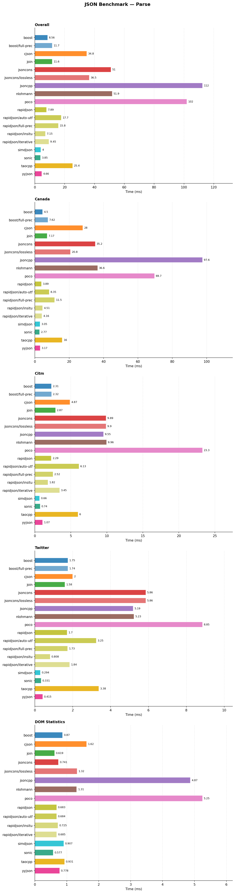
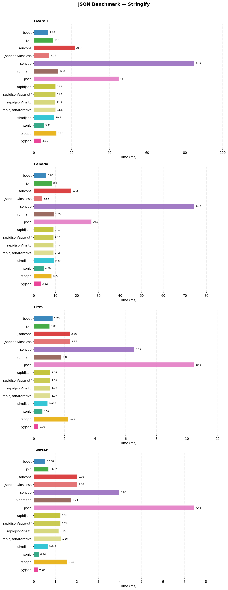
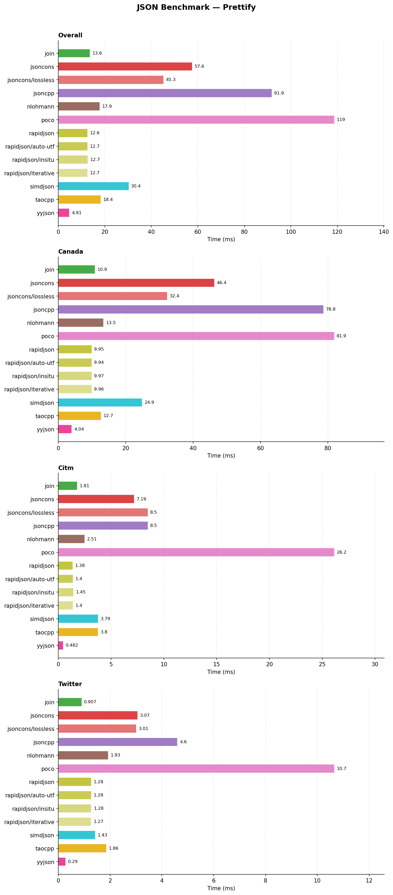
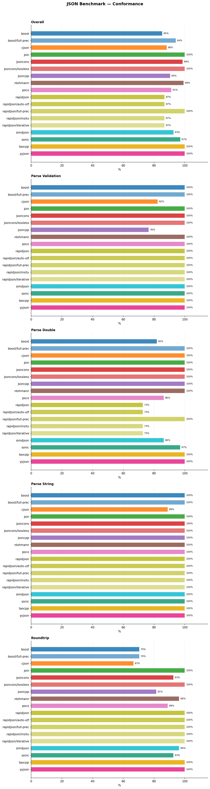

# json-benchmark

Comparative benchmarks of JSON libraries in C++, measuring parse, stringify, prettify, and DOM statistics performance across three real-world datasets (Canada, CitmCatalog, Twitter). Includes a conformance suite covering parse validation, double precision, string decoding, and roundtrip correctness.

Largely inspired by [nativejson-benchmark](https://github.com/miloyip/nativejson-benchmark) by Milo Yip.

## Table of contents

- [Libraries](#libraries)
- [Datasets](#datasets)
- [Build](#build)
- [Running benchmarks](#running-benchmarks)
- [Plots](#plots)
- [What the benchmarks measure](#what-the-benchmarks-measure)
  - [Parse](#parse)
  - [Stringify](#stringify)
  - [Prettify](#prettify)
  - [Statistics](#statistics)
  - [Conformance](#conformance)
- [Notes](#notes)
- [Test machine](#test-machine)
- [Results](#results)
  - [Performance](#performance)
  - [Conformance](#conformance-1)
  - [Conclusion](#conclusion)
- [License](#license)

## Libraries

| Library | Parse | Stringify | Prettify | Statistics | Conformance |
|---------|-------|-----------|----------|------------|-------------|
| [Boost.JSON](https://www.boost.org/doc/libs/release/libs/json/) (default) | ✓ | ✓ | — | ✓ | ✓ |
| [Boost.JSON](https://www.boost.org/doc/libs/release/libs/json/) (full-prec) | ✓ | — | — | — | ✓ |
| [cJSON](https://github.com/DaveGamble/cJSON) | ✓ | — | — | ✓ | ✓ |
| [Join](https://github.com/joinframework/join) | ✓ | ✓ | ✓ | ✓ | ✓ |
| [jsoncons](https://github.com/danielaparker/jsoncons) (default) | ✓ | ✓ | ✓ | ✓ | ✓ |
| [jsoncons](https://github.com/danielaparker/jsoncons) (lossless) | ✓ | ✓ | ✓ | ✓ | ✓ |
| [JsonCpp](https://github.com/open-source-parsers/jsoncpp) | ✓ | ✓ | ✓ | ✓ | ✓ |
| [nlohmann/json](https://github.com/nlohmann/json) | ✓ | ✓ | ✓ | ✓ | ✓ |
| [POCO JSON](https://pocoproject.org/) | ✓ | ✓ | ✓ | ✓ | ✓ |
| [RapidJSON](https://github.com/Tencent/rapidjson) (auto-utf) | ✓ | ✓ | ✓ | ✓ | ✓ |
| [RapidJSON](https://github.com/Tencent/rapidjson) (default) | ✓ | ✓ | ✓ | ✓ | ✓ |
| [RapidJSON](https://github.com/Tencent/rapidjson) (full-prec) | ✓ | — | — | — | ✓ |
| [RapidJSON](https://github.com/Tencent/rapidjson) (insitu) | ✓ | ✓ | ✓ | ✓ | ✓ |
| [RapidJSON](https://github.com/Tencent/rapidjson) (iterative) | ✓ | ✓ | ✓ | ✓ | ✓ |
| [simdjson](https://github.com/simdjson/simdjson) | ✓ | ✓ | ✓ | ✓ | ✓ |
| [sonic-cpp](https://github.com/bytedance/sonic-cpp) | ✓ | ✓ | — | ✓ | ✓ |
| [taocpp/json](https://github.com/taocpp/json) | ✓ | ✓ | ✓ | ✓ | ✓ |
| [yyjson](https://github.com/ibireme/yyjson) | ✓ | ✓ | ✓ | ✓ | ✓ |

All dependencies are fetched automatically via CMake FetchContent.

Prettify only measures native indentation support. **Boost.JSON** and **sonic-cpp** have none and are excluded from it; **simdjson** serialises with its native `simdjson::to_string` and `simdjson::prettify`. **sonic-cpp** requires x86-64 with AVX2.

**cJSON** is excluded from stringify and prettify. Its writer prints a double with 15 significant digits whenever the result compares equal within `DBL_EPSILON` (`print_number`), so its output is shorter and not exact (1.94 MB instead of 2.09 MB on `canada.json`); `cJSON_Print` also indents with tabs and keeps arrays on a single line, producing 4× less text. Its stringify is still used for the roundtrip score. It is parsed with `cJSON_ParseWithLength`, its native lenient mode that ignores trailing content, and its strings stop at the first `\u0000`.

**ArduinoJson** was evaluated and left out: its default nesting limit (10) rejects `jsonchecker/pass02.json`, and it serialises doubles with about 9 significant digits, so its stringify output for `canada.json` is both shorter and numerically wrong.

**jsoncons**, **taocpp/json** and **sonic-cpp** are header-only. taocpp/json requires PEGTL (also header-only) as a mandatory dependency, fetched automatically.

Boost.JSON is benchmarked in two configurations to isolate the impact of its number parsing mode:
- **default** — `number_precision::imprecise`, fast float parsing
- **full-prec** — `number_precision::precise`, bitwise-accurate doubles at the cost of throughput

jsoncons is benchmarked in two configurations:
- **default** — numbers converted to `int64`/`double` at parse time
- **lossless** — `lossless_number(true)`, decimal numbers kept as their original text (tagged `bigdec`) and written back verbatim (`bigint_chars_format::number`)

RapidJSON is benchmarked in five configurations to isolate the impact of its parser options:
- **default** — standard UTF-8, fast float parsing
- **full-prec** — `kParseFullPrecisionFlag`, bitwise-accurate doubles at the cost of throughput
- **iterative** — `kParseIterativeFlag`, stack-allocated iterative descent (no system stack recursion)
- **insitu** — `kParseInsituFlag`, in-place string unescaping directly in the source buffer
- **auto-utf** — `AutoUTFInputStream`, auto-detect UTF-8/16/32 encoding

The full-prec variants only change number parsing, so they are measured in parse and conformance only.

RapidJSON's `kParseNumbersAsStringsFlag` has no lossless counterpart here: its DOM stores such numbers as plain strings, which lose their number type and serialise quoted.

## Datasets

| File | Size | Characteristics |
|------|------|-----------------|
| `canada.json` | ~2.2 MB | Geometry data — float-heavy (coordinate pairs), large arrays |
| `citm_catalog.json` | ~1.7 MB | Event catalog — deeply nested objects, mixed types |
| `twitter.json` | ~0.6 MB | Social feed — Unicode strings, many small objects |

Each benchmark binary is run several times, each repetition in a new process. The time reported is the minimum across repetitions, and the overall time is the sum over the three datasets (ms), computed per repetition before taking the minimum.

## Build

Configure:

```bash
cmake -B build -DCMAKE_BUILD_TYPE=Release
```

Compile:

```bash
cmake --build build -j$(nproc)
```

## Running benchmarks

Run everything and generate plots:

```bash
bash scripts/run_bench.sh
```

Single binary (one per operation and library, `bench_<operation>_<library>`):

```bash
GLIBC_TUNABLES=glibc.malloc.mmap_threshold=33554432:glibc.malloc.trim_threshold=4294967296 \
taskset -c 2 ./build/benchmarks/performance/bench_parse_yyjson \
    --benchmark_format=json \
    --benchmark_out=results/parse_yyjson.json \
    --benchmark_min_warmup_time=0.5
```

Conformance only:

```bash
./build/benchmarks/conformance/conformance --output results/conformance.json
```

> [!NOTE]
> Default: 3 repetitions per binary (`REPETITIONS`), each in a new process, minimum reported. Override with e.g. `REPETITIONS=5 bash scripts/run_bench.sh`. Raw per-repetition results are written to `results/runs/`.

## Plots

Install plotting dependencies, either from the distribution (Debian/Ubuntu):

```bash
sudo apt install python3-matplotlib python3-pandas
```

or in a virtual environment:

```bash
python3 -m venv .venv
.venv/bin/pip install -r plots/requirements.txt
```

Generate the charts:

```bash
python3 plots/plot.py results/conformance.json results/runs/*.json
```

Bars show the minimum across processes.

PNGs are written to `plots/`:
- `performance_parse.png` — parse (overall + per dataset) and DOM statistics
- `performance_stringify.png` — stringify (overall + per dataset)
- `performance_prettify.png` — prettify (overall + per dataset)
- `conformance.png` — overall score followed by one subplot per category (parse validation, parse double, parse string, roundtrip)

## What the benchmarks measure

### Parse

**Goal**: time to parse a JSON document into an in-memory DOM.

The benchmark calls `Adapter::parse(json)` and measures only the parsing time. DOM destruction is excluded from timing (`PauseTiming` / `ResumeTiming`): some libraries free memory as a single pool (`RapidJSON`), others free each array, object and string individually (`nlohmann`, `Join`). Excluding destruction matches nativejson-benchmark's convention and isolates the parsing cost.

**What is measured**: tokenisation, UTF-8 validation, number parsing, and DOM construction.

**What is not measured**: DOM traversal, serialisation, input I/O.

---

### Stringify

**Goal**: time to serialise a pre-parsed DOM back to a compact (minified) JSON string.

The document is parsed once before the timing loop; each iteration serialises the same DOM.

**What is measured**: DOM traversal and JSON text generation, including number-to-string conversion and string escaping.

---

### Prettify

**Goal**: time to serialise a DOM to indented JSON (4-space indent).

Same protocol as stringify. Measures the added cost of indentation logic on top of standard serialisation.

Each library writes its native format. Output volumes match within a few percent, with two exceptions: **JsonCpp** writes short arrays on a single line (a hard-coded 74-column margin), producing 2.1× less text on `canada.json`, and prints doubles with 17 significant digits; **POCO** writes empty containers over two lines (+15% on `citm_catalog.json`). Their figures are therefore not strictly like-for-like.

---

### Statistics

**Goal**: time to traverse the entire DOM and accumulate counts of each node type (objects, arrays, strings, numbers, booleans, nulls).

The document is parsed once before the timing loop. Each iteration walks every node in the tree.

**What is measured**: DOM traversal cost — cache efficiency of the library's node layout, virtual dispatch or type-switch overhead, and branch prediction under the mixed node types of real-world documents.

---

### Conformance

Four correctness categories, run once (no timing):

1. **Parse Validation** (`jsonchecker/`): accept all `pass*.json` files, reject all `fail*.json` files. 34 cases.
2. **Parse Double**: parse a JSON array containing a single number and compare the result bitwise against the expected `double`. 66 cases, sourced from nativejson-benchmark's `roundtrip/` and edge-case suite.
3. **Parse String**: parse a JSON array containing a single string and compare the decoded bytes exactly. 9 cases covering escape sequences and Unicode surrogates.
4. **Roundtrip**: parse a JSON document, stringify it, and compare the output byte-for-byte against the input. 27 cases.

In addition, an **output check** guards the performance benchmarks: on each dataset and each `jsonchecker/pass*.json` file, the DOM statistics of every library must match, and re-parsing a library's own `stringify` and `prettify` output must yield the same statistics. On the three datasets — the timed inputs — the output is also compared value by value with the input, using **yyjson** (136/136) as the reference reader: numbers must be equal as doubles, strings byte for byte, objects key by key regardless of order. Adapters whose number round trip is lossy by design are exempt: cJSON, whose writer is approximate, and the imprecise parse modes of Boost.JSON and RapidJSON, whose DOM already differs from the input by one ulp on some doubles — their writer is the one their `full-prec` variant uses, which passes the comparison. Any mismatch is reported on stderr and makes `conformance` exit with status 1, which stops `run_bench.sh` before any timing.

## Notes

- `-march=native`: CPU-specific SIMD optimisations. Results are not portable across machines.
- Timing uses Google Benchmark's default wall-clock timer. simdjson reuses a single `dom::parser` across iterations (its recommended usage), so its scratch buffers are allocated once; each parse still builds its own `dom::document`, destroyed outside the timed region like every other DOM.
- `--benchmark_min_warmup_time=0.5` lets the heap reach its steady-state size before measurement: without it, POCO and jsoncons `lossless` parse on `canada.json` still took up to 35 page faults per iteration.
- The minimum across repetitions is reported: noise only ever adds time. For the libraries most sensitive to memory layout (jsoncons stringify and prettify), it also picks the most favourable layout among the processes.
- Each library is measured in its own binary (`bench_<operation>_<library>`), linked only against that library. With every library in one binary, the code and heap layout of one library depended on the others: yyjson's statistics varied by up to 2× depending on which other libraries shared the binary, and dropping an unrelated library from the binary was enough to move it.
- Each repetition runs in a new process, interleaved across libraries. Repetitions within one process would share one memory layout and allocation history, so their spread would underestimate the real uncertainty.
- The allocator policy is fixed for every library (`GLIBC_TUNABLES`: 32 MB `mmap` threshold, trimming disabled). glibc's dynamic `mmap` threshold otherwise depends on the allocation history of the process: a library whose output buffer is allocated with `mmap` takes about 2 000 page faults per iteration on `canada.json`, while the libraries measured after it, the threshold raised in the meantime, reuse a warm heap. Each benchmark reports its page faults per iteration as the `minflt` counter; with the policy fixed it stays at zero in steady state, and `plot.py` warns when it does not.
- Benchmarks are pinned with `taskset -c $BENCH_CPU` (default 2, a physical core away from CPU 0, which takes most interrupts). They are single-threaded, so pinning the process pins the measured thread.
- Build and measurement are separated. `run_bench.sh` refuses to measure unless the governor is `performance` and boost is disabled, then waits until the maximum per-core frequency in `/proc/cpuinfo` is back to 98% of the rated clock: a `-j$(nproc)` compile heats the package enough that the first benchmark afterwards runs below it. `ALLOW_NOISY=1` overrides both checks.
- A reusable parser object is kept across iterations when the library's API provides one (simdjson `dom::parser`, Boost.JSON `parser`, JsonCpp `CharReader`, POCO `Parser`); the DOM itself is always built fresh and destroyed outside the timed region.
- Every compiled library is linked statically: `BUILD_SHARED_LIBS` is forced off before the first dependency is declared. Set any later, a fresh configure built Boost.JSON, simdjson, yyjson and JsonCpp as shared libraries, which slowed Boost.JSON statistics by 30%.
- Every library runs with its default allocator (Boost.JSON with plain `new`/`delete` rather than a `monotonic_resource`, yyjson without a pool, RapidJSON with its built-in `MemoryPoolAllocator`); no adapter installs a custom one.
- Stringify and prettify return each library's native output buffer (`std::string`, RapidJSON `StringBuffer`, sonic `WriteBuffer`, yyjson's `malloc`ed block) without converting it, so no library pays an extra copy.
- Result JSONs are gitignored (`results/`); plots are committed under `plots/`.

## Test machine

All figures below come from a single run on this machine (3 repetitions, each in its own process). They are not portable: `-march=native` alone makes them specific to this CPU.

| | |
|---|---|
| CPU | AMD Ryzen 7 2700X, 8 cores / 16 threads (Zen+), 1 socket, 1 NUMA node |
| Frequency | 3700 MHz, `performance` governor, boost disabled |
| Caches | L1d 8 × 32 KiB, L2 8 × 512 KiB, L3 2 × 8 MiB |
| RAM | 16 GiB |
| OS | Ubuntu 26.04.1 LTS, kernel 7.0.0-38-generic |
| Toolchain | GCC 15.2.0, CMake 4.2.3 |
| Compile flags | `-O3 -DNDEBUG -march=native -std=c++17` |
| Pinning | `taskset -c 2` (physical core, SMT sibling 10) |
| Conditions | idle machine, 3 repetitions, run started once the CPU was back to its rated clock; spread across repetitions below 2% for 111 of 186 benchmarks and below 5% for 142; outliers are one Join parse process on `canada.json` (30% slower than the others) and jsoncons stringify/prettify (up to 38%) |

## Results

Measured on a development machine. Re-run `scripts/run_bench.sh` to reproduce on other hardware; results are not portable across machines (`-march=native`).

### Performance







**Parse**: **sonic-cpp** (3.85 ms) and **simdjson** (4.00 ms) lead, with **yyjson** (4.66 ms) close behind; all three are SIMD-based. Among the other DOM libraries, **RapidJSON** in-situ (7.15 ms) leads thanks to its zero-copy string handling, followed by the default variant (7.89 ms), **Boost.JSON** (8.56 ms) and **RapidJSON** iterative (9.45 ms). **Join** (11.6 ms) and **Boost.JSON** `full-prec` (11.7 ms) follow. Full-precision number parsing costs **Boost.JSON** +37% (8.56 → 11.7 ms) but **RapidJSON** +100% (7.89 → 15.8 ms), almost entirely on the float-heavy `canada.json`. **RapidJSON** auto-utf (17.7 ms) pays for encoding detection. **taocpp/json** (25.4 ms) and **cJSON** (34.8 ms, slow on `canada.json` floats) follow. **jsoncons** is faster in `lossless` mode (36.5 ms against 51.0 ms), since it keeps numbers as text instead of converting them; **nlohmann/json** (51.9 ms) sits alongside the default mode. **POCO** (102 ms) and **JsonCpp** (112 ms) trail significantly.

**Stringify**: **yyjson** leads at 3.81 ms, followed by **sonic-cpp** (5.41 ms), **Boost.JSON** (7.63 ms) and **jsoncons** `lossless` (8.25 ms), which writes its numbers back verbatim. **Join** (10.1 ms) comes next, ahead of **simdjson** (10.8 ms), the **RapidJSON** variants (11.4–11.6 ms), **taocpp/json** (12.1 ms) and **nlohmann/json** (12.8 ms). **jsoncons** in its default mode (21.7 ms) is slower; **POCO** (45 ms) and **JsonCpp** (84.9 ms) are the slowest.

**Prettify**: **yyjson** leads by a wide margin at 4.81 ms. The **RapidJSON** variants (12.6–12.7 ms) and **Join** (13.6 ms) follow, then **nlohmann/json** (17.9 ms) and **taocpp/json** (18.4 ms). **simdjson** (30.4 ms) is slower, as are **jsoncons** (45 ms `lossless`, 58 ms default). **JsonCpp** (92 ms) and **POCO** (119 ms) trail by a wide margin.

**Statistics**: **sonic-cpp** leads at 0.58 ms, with **Join** (0.62 ms) right behind. The **RapidJSON** variants (0.68–0.73 ms), whose contiguous memory pool keeps the DOM cache-friendly, follow, along with **jsoncons** (0.74 ms) and **yyjson** (0.78 ms). **Boost.JSON** (0.87 ms), **simdjson** (0.91 ms) and **taocpp/json** (0.93 ms) come next, then **nlohmann/json** (1.31 ms), **jsoncons** `lossless` (1.32 ms; its numbers stay text, which slows `canada.json`) and **cJSON** (1.62 ms). **JsonCpp** (4.9 ms) and **POCO** (5.3 ms) remain the outliers.

Raw throughput is only part of the picture. A parser that silently accepts malformed input, produces slightly wrong floating-point values, or mangles escape sequences can introduce subtle bugs that are hard to reproduce and trace. The conformance suite measures what matters in production: does the library correctly reject invalid JSON, parse numbers to the right `double`, decode strings exactly as the spec requires, and reproduce the original representation on roundtrip?

### Conformance



**Parse Validation**: most libraries pass all 34 cases. **JsonCpp** fails 8 (it is lenient on some constructs that the JSON spec rejects, such as comments). **cJSON** fails 6: its native `cJSON_ParseWithLength` ignores content after the value (3 cases), and it accepts a leading zero (`013`) and raw tab or line-break characters inside strings.

**Parse Double**: the sharpest differentiator. **Join**, **jsoncons** (both modes), **JsonCpp**, **nlohmann/json**, **taocpp/json**, **yyjson**, **cJSON**, and the `full-prec` modes of **RapidJSON** and **Boost.JSON** achieve perfect precision (66/66). **sonic-cpp** misses 2, both mantissas longer than 19 digits followed by an exponent. **POCO** and **simdjson** pass 57/66: the 9 misses are all integers beyond 64 bits written without a fraction or exponent, which POCO rejects and simdjson's DOM reports as `BIGINT_ERROR`; their floating-point parsing is exact. **RapidJSON**'s default, iterative, insitu, and auto-utf modes fail 18 cases and **Boost.JSON**'s default mode fails 12 — both trade precision for speed using a fast-path float parser, and their `full-prec` modes close the gap.

**Parse String**: all libraries pass all 9 cases except **cJSON** (8/9), whose strings stop at the first `\u0000`.

**Roundtrip**: **Join**, **jsoncons** (`lossless`), **taocpp/json**, **yyjson**, and all five **RapidJSON** variants achieve a perfect 27/27. **nlohmann/json** and **simdjson** get 26/27, **jsoncons** (default) and **sonic-cpp** 25/27, **POCO** 24/27 and **JsonCpp** 22/27. **Boost.JSON** reaches 19/27 in both modes — its serialiser does not reproduce the exact decimal representation of floats from the input, and full-precision parsing does not change that — and **cJSON** 18/27.

The output check also caught a writer bug in **taocpp/json** that the roundtrip cases miss: `1.23456789e-13` (from `jsonchecker/pass01.json`) is written as `1.234567872442244e-16`, a different value. Its output on the three benchmark datasets is exact, so its timings stand.

### Conclusion

The best libraries are those that are both fast and correct. Several stand out on both axes:

- **yyjson** is the strongest library overall: perfect conformance (136/136), the fastest stringify (3.81 ms) and prettify (4.81 ms) by a wide margin, and a parse (4.66 ms) within 25% of the SIMD leaders.
- **sonic-cpp** has the fastest parse (3.85 ms) and leads statistics (0.58 ms), with a fast stringify (5.41 ms). It has no indented output, misses 2 double-precision cases (132/136), and needs AVX2.
- **simdjson** parses at 4.00 ms with exact floating-point parsing, but rejects integers beyond 64 bits (126/136) and its DOM is read-only: it can serialise a parsed document, more slowly (10.8 ms minified, 30.4 ms pretty), but not modify it.
- **RapidJSON** remains a fast general-purpose DOM: `insitu` (7.15 ms) and `default` (7.89 ms) parse, ~0.7 ms statistics, ~12.6 ms prettify. `full-prec` doubles the parse cost (15.8 ms) and reaches perfect conformance (136/136); the other modes give up 18 double-precision cases.
- **Join** achieves perfect conformance (136/136) with balanced performance: second in statistics (0.62 ms), close to RapidJSON in prettify (13.6 ms), mid-pack in stringify (10.1 ms) and parse (11.6 ms).
- **Boost.JSON** has a fast default parser (8.56 ms) and stringify (7.63 ms). `full-prec` fixes double parsing (66/66) for +37% parse time, a cheaper precision upgrade than RapidJSON's, but its roundtrip score (19/27) remains a concern if exact decimal reproduction of floats matters.
- **taocpp/json** reaches perfect conformance (136/136) with competitive serialisation (stringify 12.1 ms, prettify 18.4 ms) and a 25.4 ms parse, but has a writer bug on some small exponents (see Conformance).
- **nlohmann/json** offers perfect double precision and near-perfect roundtrip (26/27) in a widely used, ergonomic API, at the cost of parse throughput (52 ms).
- **jsoncons** reaches 134/136 by default and 136/136 in `lossless` mode, which is also faster to parse (37 ms) and stringify (8.2 ms) but slower on numeric statistics.
- **cJSON** is small and portable, but lenient on invalid input (28/34) with lossy float output and a 34.8 ms parse.
- **JsonCpp** and **POCO** are consistently the slowest in every performance category and offer no conformance advantage. They are best avoided in performance-sensitive code.

## License

Licensed under the [MIT License](LICENSE).
